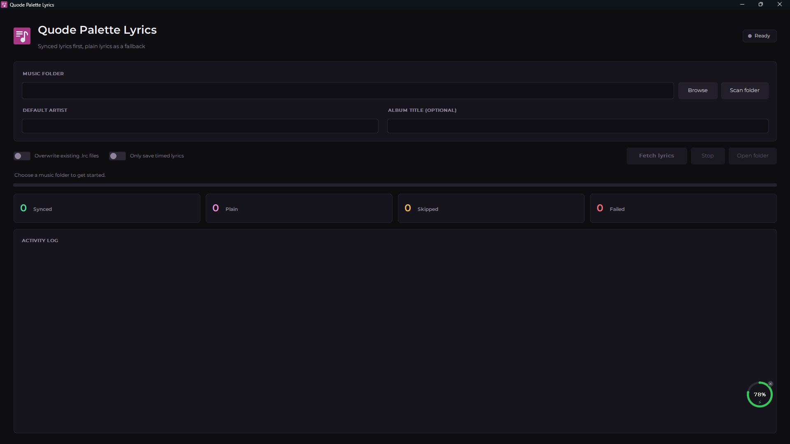
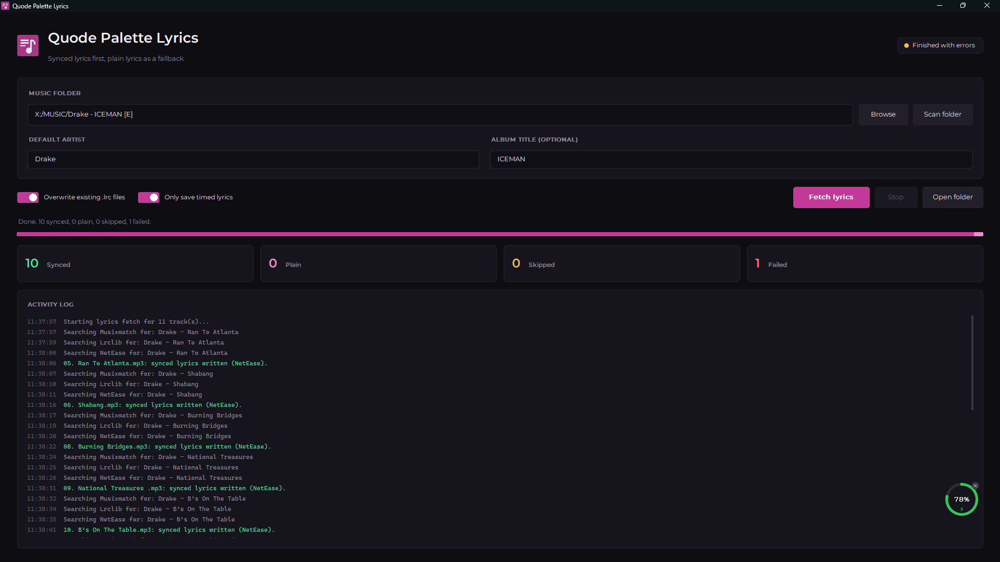
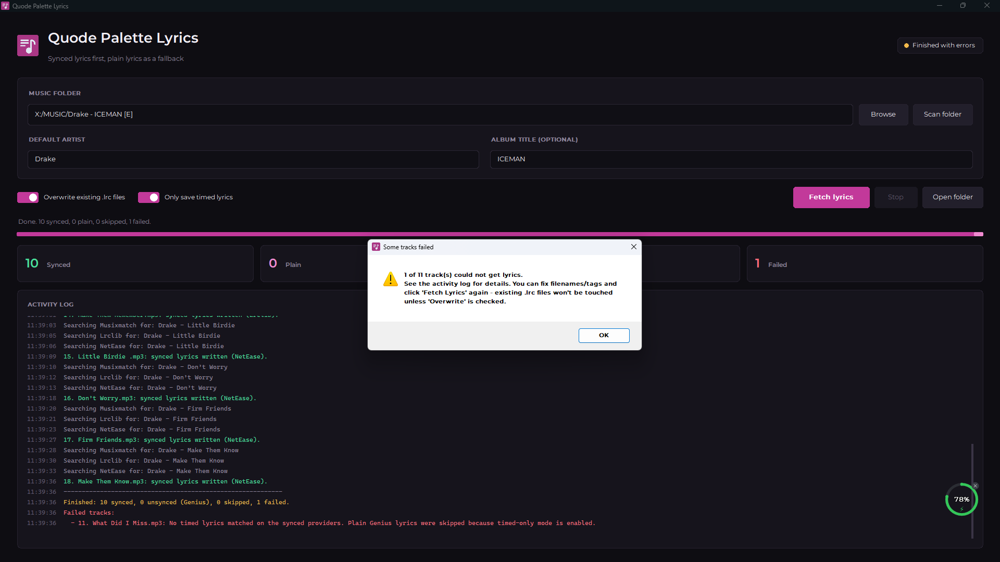

# Quode Palette Lyrics

Quode Palette Lyrics finds lyrics for audio files in a music folder and saves `.lrc` files beside the tracks. It checks several synced-lyrics providers first and can use plain Genius lyrics when timed lyrics are unavailable.

  
  <b>Screenshot I</b>

<table>
    <td width="50%" align="center">
      
       
      <b>Screenshot II</b>
       
      <!-- Convert common audio formats with FFmpeg -->
    </td>
    <td width="50%" align="center">
      
       
      <b>Screenshot III</b>
       
      <!-- Convert common video formats with FFmpeg -->
    </td>
</table>

## Features

- Scan a folder for MP3, FLAC, WAV, M4A, OGG, OPUS, WMA, and AAC files.
- Read artist, title, album, and duration from audio tags when available.
- Use filenames and default artist or album values when tags are missing.
- Try Musixmatch, LRCLIB, NetEase, and Megalobiz for timed lyrics.
- Use Genius as a plain-lyrics fallback unless timed-only mode is enabled.
- Keep existing `.lrc` files by default, with an option to overwrite them.
- Show progress and lookup results in the activity log.
- Bundle the Montserrat font and Quode Palette icon with the app.

## Fonts

The font is under the SIL Open Font License.

## License

Released under the [PolyForm Noncommercial License 1.0.0](LICENSE). You are free to use, modify and share it for personal, educational and other noncommercial purposes. For commercial use, please get in touch.
[Email Us](mailto:hello@quodepalette.com)